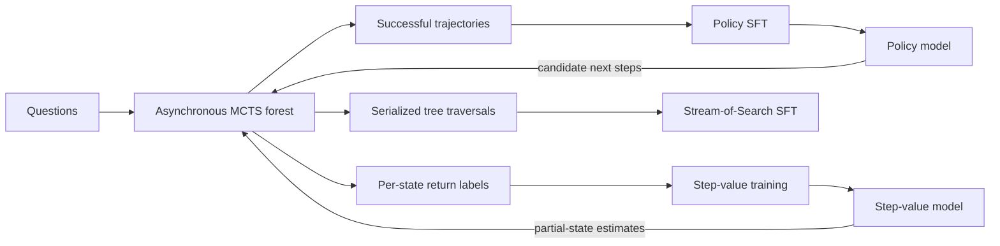

# Explicit versus learned search

Research software for learning from search and comparing two ways of organizing it:

- **External search:** a Monte Carlo tree controller stores branches and statistics outside the model. A learned policy proposes arithmetic steps; a learned value model evaluates partial solutions.
- **Contextual search:** a language model is trained on serialized search traversals, including branch relationships, and generates a search trace before its final answer.

The project was developed across Stanford CS224N and CS224R in 2025 by **Angel Raychev, Yalcin Tur and Mihajlo Stojkovic**. The CS224R report credits Angel as lead developer, including the search implementation, training pipelines and experiments; Yalcin and Mihajlo contributed the initial prototype. Anjiang Wei and Rafael Rafailov mentored the earlier CS224N project.

**Start here:** [Technical article](https://angelraychev.com/explicit-versus-learned-search/) · [Technical note PDF](https://angelraychev.com/research/explicit-learned-search/explicit-versus-learned-search.pdf) · [Original Stanford CS224R report](https://cs224r.stanford.edu/spring_2025/projects/pdfs/CS_224R_Final_Report__3_%20%281%29.pdf) · [Architecture](docs/ARCHITECTURE.md) · [Running the software](docs/RUNNING.md) · [Status](docs/STATUS.md).

## What is implemented

The arithmetic domain generalizes Game of 24: use the supplied numbers once each, with the four basic binary operations, to reach a specified target.



The tree is a training-data source as well as an inference-time controller:

| Component | Implementation |
| --- | --- |
| Batched tree search | An asynchronous forest queues expansion requests across multiple trees; separate policy and value services process the requests in batches. |
| Policy learning | Successful terminal trajectories become question/completion SFT examples. Iteration scripts advance model and dataset identifiers. |
| Step-value learning | Search outcomes are backed up into intermediate return labels. A custom trainer masks the loss to newline-aligned state positions and trains a selected vocabulary logit with binary cross-entropy. These targets can be soft returns, not just binary terminal labels. |
| Search-trace learning | First-visit node traversals are serialized with node/ancestor relationships and a selected successful answer. The resulting examples train a causal language model to emit a search process. |
| Contextual self-training | The SoS runner can collect successful completions from unresolved questions for subsequent SFT. |
| Evaluation | MCTS selects a final trajectory using backed-up Q values and verifies its final expression. The contextual runner verifies the answer segment of a generated trace. |

“External” does **not** mean unlearned or brute force: the controller uses neural proposal and value models. “Contextual” describes where the search trajectory is represented, not a claim of fundamentally greater computability.

## CPU quickstart: no models, credentials or GPU

Python **3.10 or later** is required. From the repository root:

```bash
python3 -m unittest discover -s tests -v
python3 -m compileall -q utils evaluate generate_data train _scripts_mcts _scripts_sos
```

These checks use only the Python standard library. They exercise the exact arithmetic verifier, both actor-output formats, max-Q selection, terminal-value behavior, backed-up labels and evaluation denominator accounting. They do not download weights, call model services or run training. CI runs the same checks.

For example, the verifier can be used independently:

```python
from utils.arithmetic import verify_equation

assert verify_equation("Use 3, 3, 8, 8 to make 24.", "8/(3-8/3)=24")
assert not verify_equation("Use 2, 3, 3, 4 to make 7.", "2**3+3-4=7")
```

The shared verifier parses a restricted arithmetic syntax tree and evaluates it with exact rational arithmetic; it never executes the expression as Python code. It enforces number multiplicity and rejects exponentiation, floor division, unary operators, arbitrary code, missing answer markers and valid-looking substrings inside malformed answers. See [the precise contract](docs/ARCHITECTURE.md#exact-answer-verification).

## Training and model-backed evaluation

The original launchers, trainers and services are retained. They target a **Linux/NVIDIA CUDA environment**, not a CPU-only laptop. [Running the software](docs/RUNNING.md) maps the entry points, local service ports, dataset schemas, model identifiers and side effects.

The historical dependency pins are in [`requirements.txt`](requirements.txt). This cleanup has **not** requalified the CUDA/vLLM stack or rerun the original training study. Full historical datasets, split manifests, raw evaluation outputs and every reported checkpoint are not bundled here. A successful CPU check is not a claim that installing the requirements reproduces the report's figures.

Experimental weights remain available on [Angel's Hugging Face profile](https://huggingface.co/AngelRaychev), including examples of [policy](https://huggingface.co/AngelRaychev/0.5B-policy-iteration_6), [value](https://huggingface.co/AngelRaychev/1.5B-value-iteration_2) and [SoS](https://huggingface.co/AngelRaychev/0.5B-sos-iteration_1_b21_e42_epochs16) artifacts. These links identify different experimental configurations; they are **not** a matched turnkey checkpoint bundle. Choose compatible model/tokenizer revisions and data explicitly. An `iteration_0` model can be a base initialization rather than a trained search model.

**Before running a trainer, review its Hub settings.** The historical training scripts automatically push checkpoints to public Hugging Face model repositories. Change the destinations and disable publishing in the trainer code if you only want local output. No credentials belong in source or configuration files.

## Research scope

The existing work investigates how search-generated supervision, learned values and inference-time exploration interact. It does not prove that one approach universally dominates, or that a contextual model can solve a finite arithmetic problem that exhaustive legal enumeration could never solve.

A careful continuation would ask when an external structured controller and a trace-trained model differ in **efficiency or structural generalization** under specified training resources, information access and measured inference budgets. Policy calls, value calls and long-context processing all count; equal output tokens or parameter counts alone are not equivalent compute.

The original 2025 source remains accessible at [`1a7fda1`](https://github.com/RaychevAngel/classical_vs_contextual_search/tree/1a7fda10617d34ccd3a87c825cba71e4429de91a). Current maintenance corrects verification and result-accounting behavior but **does not retroactively revalidate historical scores or figures**. See [status and boundaries](docs/STATUS.md) for the distinction between implemented methods, retained reports and a future controlled comparison.
